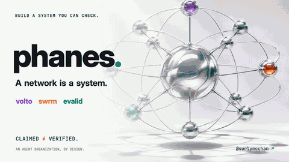
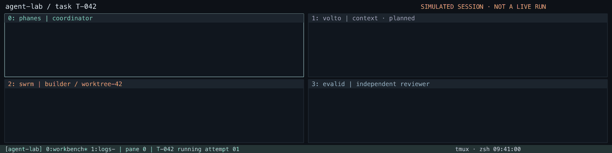

# Hi, I'm Nick 👋

**Follow along:** I share what breaks (and what fixes it) putting AI agents into production — [**@surlymochan on X**](https://x.com/surlymochan) · [Contra](https://contra.com/chao_chen_p9d4xc5f)

> ⭐ **If evalid or swrm saves you time, a star is the best way to support the work — I'm pushing for 100 stars this month.**

**AI agents · Harness engineering · Reliable loops & graphs**

I build tools to coordinate coding agents and verify what they deliver.

  

## Start Here

> **Claimed ≠ verified.** I’m building agent systems where delivery is an evidence trail, not a status update.

<table>
  <thead><tr><th width="140" align="left">Project</th><th width="480" align="left">What it does</th><th width="160" align="left">Status</th></tr></thead>
  <tbody>
    <tr><td valign="middle"><strong><a href="https://github.com/surlymochan/phanes">Phanes</a></strong></td><td valign="middle">Coordinates goals, distributed execution and verified acceptance.</td><td valign="middle">Consolidating</td></tr>
    <tr><td valign="middle"><strong><a href="https://github.com/surlymochan/volto">volto</a></strong></td><td valign="middle">Planned roles, memory and knowledge for collaborating agents.</td><td valign="middle">Planned relaunch</td></tr>
    <tr><td valign="middle"><strong><a href="https://github.com/surlymochan/swrm">swrm</a></strong></td><td valign="middle">Dispatches coding agents with leases, isolated worktrees and limits.</td><td valign="middle">Available</td></tr>
    <tr><td valign="middle"><strong><a href="https://github.com/surlymochan/evalid">evalid</a></strong></td><td valign="middle">Seals test-run snapshots and replays them to verify results.</td><td valign="middle">Available</td></tr>
  </tbody>
</table>

### A small, public comparison

On six selected hard SWE-bench Verified issues, each arm used Pi with DeepSeek-V4.1-Flash, one run per issue, and a 20-minute cap. A solve means the official tests passed: **swrm 5/6 · evalid 4/6 · plain agent 3/6 · Superpowers 2/6**. This is a small project-reported experiment, not a general leaderboard; raw runs and methodology are in the [swrm benchmark](https://github.com/surlymochan/swrm/tree/main/bench/swebench) and [evalid benchmark](https://github.com/surlymochan/evalid/tree/main/bench/swebench).

## Contributions & PR Activity

<!-- PR-CHARTS:START -->
Opened and merged PRs across my projects, nibiru-labs and upstream repositories, including co-authored work. Monthly totals use Singapore time.

<!-- PR-CHARTS:END -->

  <picture>
    <source media="(prefers-color-scheme: dark)" srcset="https://github-profile-summary-cards.vercel.app/api/cards/profile-details?username=surlymochan&theme=github_dark">
    
  </picture>

<table>
  <tr>
    <td width="50%">
      <picture>
        <source media="(prefers-color-scheme: dark)" srcset="https://streak-stats.demolab.com?user=surlymochan&hide_border=true&theme=github-dark-blue">
        
      </picture>
    </td>
    <td width="50%">
      <picture>
        <source media="(prefers-color-scheme: dark)" srcset="https://github-readme-stats-one-bice.vercel.app/api?username=surlymochan&show_icons=true&hide_border=true&theme=github_dark">
        
      </picture>
    </td>
  </tr>
</table>

## Open Source

Recent merged contributions:

- **[senpi](https://github.com/code-yeongyu/senpi/pull/6169)** — fenced session-less wire-status reads and added per-session fence tests.
- **[senpi](https://github.com/code-yeongyu/senpi/pull/6156)** — priced Codex turns at the sent tier when the backend echoes auto/default.
- **[senpi](https://github.com/code-yeongyu/senpi/pull/6144)** — kept the pre-signal error when shutdown recovery throws.
- **[senpi](https://github.com/code-yeongyu/senpi/pull/6146)** — covered the shutdown recovery path per call site.

Currently contributing fixes to **[oh-my-openagent](https://github.com/code-yeongyu/oh-my-openagent/pulls?q=is%3Apr+author%3Asurlymochan)**, **[OpenBot](https://github.com/nightly-labs/openbot/pulls?q=is%3Apr+author%3Asurlymochan)**, and **[strands-agents/harness-sdk](https://github.com/strands-agents/harness-sdk/pulls?q=is%3Apr+author%3Asurlymochan)**. Open pull requests are proposals, not merged features or maintainer roles.

Contribution history & open pull requests

<!-- CONTRIB:START -->
Merged upstream pull requests: **66** across **17** repositories.

**code-yeongyu/senpi**

- [senpi#6343](https://github.com/code-yeongyu/senpi/pull/6343) fix(coding-agent): estimate context after a model switch instead of showing stale usage
- [senpi#6333](https://github.com/code-yeongyu/senpi/pull/6333) fix(anthropic-subscription): read the prompt-cache lifetime from loaded settings files (senpi#2988)
- [senpi#6323](https://github.com/code-yeongyu/senpi/pull/6323) fix: Ultrafast follow-ups from #2975
- [senpi#6301](https://github.com/code-yeongyu/senpi/pull/6301) fix(goal): recover a crashed goal-continuation stop on session start
- [senpi#6295](https://github.com/code-yeongyu/senpi/pull/6295) fix(coding-agent): release the anthropic-subscription pump on abort (#2974)
- [senpi#6284](https://github.com/code-yeongyu/senpi/pull/6284) fix(agent-session): refused engine-turn messages follow the transcript-failure contract
- [senpi#6279](https://github.com/code-yeongyu/senpi/pull/6279) fix(coding-agent): hide console window for win32-reachable spawns (#3965)
- [senpi#6275](https://github.com/code-yeongyu/senpi/pull/6275) fix(coding-agent): model-scoped 403 refusals no longer block the credential slot
- [senpi#6274](https://github.com/code-yeongyu/senpi/pull/6274) fix(coding-agent): stop isolated CLI re-launch replaying the caller's eval entry mode
- [senpi#6255](https://github.com/code-yeongyu/senpi/pull/6255) fix(session-backends): declare the complete bun:sqlite Database in the sqlite-bun package (#5996)
- [senpi#6222](https://github.com/code-yeongyu/senpi/pull/6222) fix(interactive): footer names the serving account when the pin is blocked (#5983)
- [senpi#6211](https://github.com/code-yeongyu/senpi/pull/6211) fix(rpc): retry a failed host-token mint before the cached token expires (#5919)
- [senpi#6264](https://github.com/code-yeongyu/senpi/pull/6264) fix(prompt-preset): render the Haiku 5.5 search-grounding sentence for Anthropic-native search
- [senpi#6232](https://github.com/code-yeongyu/senpi/pull/6232) docs(senpi-codemode): qualify process.execPath as a Bun launcher — standalone Bun only
- [senpi#6169](https://github.com/code-yeongyu/senpi/pull/6169) fix(mcp): fence session-less wire-status reads; add per-session fence tests for #3001
- [senpi#6156](https://github.com/code-yeongyu/senpi/pull/6156) fix(ai): price Codex turns at the sent tier when the backend echoes auto/default
- [senpi#6149](https://github.com/code-yeongyu/senpi/pull/6149) fix(compaction): accept valid configurationUpdate messages in retained-suffix safety (senpi#8566)
- [senpi#6146](https://github.com/code-yeongyu/senpi/pull/6146) test(coding-agent): cover the shutdown recovery path per call site (senpi#3067 L5)
- [senpi#6144](https://github.com/code-yeongyu/senpi/pull/6144) fix(coding-agent): keep the pre-signal error when shutdown recovery throws (senpi#3067 L4)
- [senpi#5997](https://github.com/code-yeongyu/senpi/pull/5997) test(kill-guard): stop owned sleepers on process exit, shorten TTL to 60s
- [senpi#5908](https://github.com/code-yeongyu/senpi/pull/5908) test(coding-agent): drive user bash through default operations in kill-guard test
- [senpi#5854](https://github.com/code-yeongyu/senpi/pull/5854) fix(codemode): probe kill-guard sleeper liveness without ps
- [senpi#5700](https://github.com/code-yeongyu/senpi/pull/5700) fix(ask-user): restore dangling questions on startup opens
- [senpi#5616](https://github.com/code-yeongyu/senpi/pull/5616) fix(claude-account): emit accounts_changed once per account add
- [senpi#5614](https://github.com/code-yeongyu/senpi/pull/5614) test(coding-agent): run source compile cache teardown even when assertions fail
- [senpi#5269](https://github.com/code-yeongyu/senpi/pull/5269) fix(retry-fallback): a 503 whose body says "Billing Scope" is not an account usage limit
- [senpi#5203](https://github.com/code-yeongyu/senpi/pull/5203) fix(coding-agent): weight CJK text in compaction cut-point budgets

**code-yeongyu/oh-my-openagent**

- [oh-my-openagent#12545](https://github.com/code-yeongyu/oh-my-openagent/pull/12545) fix(memory-core): assert the timeout-diagnostics contract, not the host's snapshot
- [oh-my-openagent#12544](https://github.com/code-yeongyu/oh-my-openagent/pull/12544) fix(omo-senpi): name the onboarding skill instead of its install path
- [oh-my-openagent#12568](https://github.com/code-yeongyu/oh-my-openagent/pull/12568) fix(memory-sync): refuse non-regular leaf files on landing
- [oh-my-openagent#12571](https://github.com/code-yeongyu/oh-my-openagent/pull/12571) test(omo-senpi): rename the buildWidgetRows resident-member case left by #12160
- [oh-my-openagent#12534](https://github.com/code-yeongyu/oh-my-openagent/pull/12534) fix(omo-native): report broken omo wrapper and duplicate omo-ai installs in doctor
- [oh-my-openagent#12529](https://github.com/code-yeongyu/oh-my-openagent/pull/12529) test(omo-senpi): require the launcher attestation on initial-namespace Linux in sandbox-engine-trust.test.ts
- [oh-my-openagent#12502](https://github.com/code-yeongyu/oh-my-openagent/pull/12502) test(team-e2e): use a collision-proof fake root pid in taskkill cases
- [oh-my-openagent#12501](https://github.com/code-yeongyu/oh-my-openagent/pull/12501) test(senpi-task): create engine agent dirs with mode 0700
- [oh-my-openagent#12040](https://github.com/code-yeongyu/oh-my-openagent/pull/12040) Fix #11570: tokenize SVG foreignObject in fact verify
- [oh-my-openagent#11909](https://github.com/code-yeongyu/oh-my-openagent/pull/11909) feat(memory): name the parked-facts cause and run log in /doctor; report retry outcomes
- [oh-my-openagent#11826](https://github.com/code-yeongyu/oh-my-openagent/pull/11826) fix(memory-core): settle the relaunched cache before asserting on the store dir in cache-persist tests
- [oh-my-openagent#11699](https://github.com/code-yeongyu/oh-my-openagent/pull/11699) fix(memory): let update_description add frontmatter to a note that has none
- [oh-my-openagent#11698](https://github.com/code-yeongyu/oh-my-openagent/pull/11698) fix(omo-senpi): freeze the shared models.json parse and type it deeply readonly
- [oh-my-openagent#11697](https://github.com/code-yeongyu/oh-my-openagent/pull/11697) fix(omo-senpi): pin competing pathspec switches off for side panel git diffs
- [oh-my-openagent#11237](https://github.com/code-yeongyu/oh-my-openagent/pull/11237) feat(hooks): persist Momus review verdicts next to the plan
- [oh-my-openagent#11228](https://github.com/code-yeongyu/oh-my-openagent/pull/11228) fix(omo-senpi): make init-deep committed mode self-contained

**Apache SkyWalking**

- [skywalking-satellite#292](https://github.com/apache/skywalking-satellite/pull/292) Fix routing key order in OTLP metrics v1 forwarder
- [skywalking-swck#232](https://github.com/apache/skywalking-swck/pull/232) Bump golang.org/x/net to v0.61.0 in adapter and operator
- [skywalking-mcp#45](https://github.com/apache/skywalking-mcp/pull/45) Bump golang.org/x/text and x/sys to clear govulncheck advisories
- [skywalking-go#258](https://github.com/apache/skywalking-go/pull/258) Bump grpc to v1.83.2 and x/net to v0.58.0 to fix known CVEs
- [skywalking-cli#236](https://github.com/apache/skywalking-cli/pull/236) fix(deps): bump grpc, x/crypto and x/net for known CVEs
- [skywalking-rover#222](https://github.com/apache/skywalking-rover/pull/222) Bump golang.org/x/net to v0.61.0 to fix HTTP/2 CVEs
- [skywalking-infra-e2e#149](https://github.com/apache/skywalking-infra-e2e/pull/149) Bump vulnerable dependencies to patched versions
- [skywalking-goapi#99](https://github.com/apache/skywalking-goapi/pull/99) Bump grpc to v1.84.0 and x/net to v0.57.0
- [skywalking-satellite#289](https://github.com/apache/skywalking-satellite/pull/289) Archive 1.3.0 changelog and start 1.4.0 section
- [skywalking-rover#220](https://github.com/apache/skywalking-rover/pull/220) Bump up grpc to 1.84.0 to fix CVE-2026-33186

**OpenSpec**

- [OpenSpec#2120](https://github.com/Fission-AI/OpenSpec/pull/2120) fix(new-change): name the configured schema in the progress line
- [OpenSpec#2116](https://github.com/Fission-AI/OpenSpec/pull/2116) perf(cli): load ora only when a spinner is shown
- [OpenSpec#2114](https://github.com/Fission-AI/OpenSpec/pull/2114) fix(verify): match REMOVED baselines by exact normalized name
- [OpenSpec#2103](https://github.com/Fission-AI/OpenSpec/pull/2103) fix(security): replace fast-glob with tinyglobby to drop braces

**nightly-labs/openbot**

- [openbot#2577](https://github.com/nightly-labs/openbot/pull/2577) Read inline triple-backtick code as text in Live Activities
- [openbot#2576](https://github.com/nightly-labs/openbot/pull/2576) Keep emoji whole when a Live Activity cuts a code span
- [openbot#2578](https://github.com/nightly-labs/openbot/pull/2578) Report an MCP sign-in that cannot start

**comet-ml/opik**

- [opik#9278](https://github.com/comet-ml/opik/pull/9278) issue-8590 SDK fix: accept repeated identical JSON objects in TS LLM-judge parser
- [opik#9271](https://github.com/comet-ml/opik/pull/9271) issue-8868 SDK fix: treat blank OPIK_API_KEY as unconfigured

**infiniflow/ragflow**

- [ragflow#21110](https://github.com/infiniflow/ragflow/pull/21110) fix(web): accept null table_column_* fields in dataset settings form

**Jenqyang/Awesome-AI-Agents**

- [Awesome-AI-Agents#687](https://github.com/Jenqyang/Awesome-AI-Agents/pull/687) Add OpenSwarm to Multi-Agent Task Solver Projects

**modelcontextprotocol/go-sdk**

- [go-sdk#1412](https://github.com/modelcontextprotocol/go-sdk/pull/1412) mcp: parse SSE field values per the SSE spec

**openclaw/openclaw**

- [openclaw#177871](https://github.com/openclaw/openclaw/pull/177871) fix(ai): preserve compatible reasoning in follow-up requests

In review (104)

- [ag-ui-protocol/ag-ui#3362](https://github.com/ag-ui-protocol/ag-ui/pull/3362) fix(adk-middleware): key text-less tool-call history messages by the first tool call id (#3254)
- [ag-ui-protocol/ag-ui#3349](https://github.com/ag-ui-protocol/ag-ui/pull/3349) fix(adk-middleware): emit backend tool calls arriving with an LRO call (#3300)
- [ag-ui-protocol/ag-ui#3341](https://github.com/ag-ui-protocol/ag-ui/pull/3341) fix(langgraph): translate CopilotKit emit events to AG-UI events (#1364)
- [ag-ui-protocol/ag-ui#3340](https://github.com/ag-ui-protocol/ag-ui/pull/3340) fix(kotlin): publish deep state without recursive StateFlow equality
- [ag-ui-protocol/ag-ui#3339](https://github.com/ag-ui-protocol/ag-ui/pull/3339) docs(langgraph): fix stale dojo run instructions
- [ag-ui-protocol/ag-ui#3336](https://github.com/ag-ui-protocol/ag-ui/pull/3336) fix(dojo): make mobile chat drag-to-close reachable
- [ag-ui-protocol/ag-ui#3335](https://github.com/ag-ui-protocol/ag-ui/pull/3335) issue-892 fix(langgraph): pass frontend tools to the model in create_agent() graphs
- [ag-ui-protocol/ag-ui#3333](https://github.com/ag-ui-protocol/ag-ui/pull/3333) issue-3311 fix(aws-strands): close inline inner tool calls left open by a failing wrapper
- [ag-ui-protocol/ag-ui#3330](https://github.com/ag-ui-protocol/ag-ui/pull/3330) issue-3213 docs: update CLAUDE.md Python SDK commands from poetry to uv
- [ag-ui-protocol/ag-ui#3326](https://github.com/ag-ui-protocol/ag-ui/pull/3326) fix(adk-middleware): keep valid inline data when BinaryInputContent also carries id/url
- [ag-ui-protocol/ag-ui#3325](https://github.com/ag-ui-protocol/ag-ui/pull/3325) issue-3077 adk-middleware fix: completed runs awaiting client tool results do not occupy concurrency slots
- [ag-ui-protocol/ag-ui#3284](https://github.com/ag-ui-protocol/ag-ui/pull/3284) fix(adk-middleware): resume HITL confirmation in the sub-agent that asked for it (#3262)
- [ag-ui-protocol/ag-ui#3265](https://github.com/ag-ui-protocol/ag-ui/pull/3265) fix(a2a): send agent.headers on A2A requests
- [ag-ui-protocol/ag-ui#3258](https://github.com/ag-ui-protocol/ag-ui/pull/3258) fix(adk-middleware): filter rewound events in adk_events_to_messages
- [ag-ui-protocol/ag-ui#3241](https://github.com/ag-ui-protocol/ag-ui/pull/3241) fix(client): give interrupts without expiresAt a bounded default expiry
- [ag-ui-protocol/ag-ui#3235](https://github.com/ag-ui-protocol/ag-ui/pull/3235) fix(mastra): stream frontend tool answers under the stored message's continuation id
- [ai-boost/awesome-harness-engineering#345](https://github.com/ai-boost/awesome-harness-engineering/pull/345) Add openflow to Verification & CI Integration
- [ai-for-developers/awesome-ai-coding-tools#1006](https://github.com/ai-for-developers/awesome-ai-coding-tools/pull/1006) Add OpenFlow to Testing and QA
- [anomalyco/opencode#59369](https://github.com/anomalyco/opencode/pull/59369) feat(tui): add an opt-out for the Kitty keyboard protocol
- [anomalyco/opencode#57237](https://github.com/anomalyco/opencode/pull/57237) fix(cli): expose retryable ACP plugin activation readiness errors
- [anomalyco/opencode#57236](https://github.com/anomalyco/opencode/pull/57236) fix(core): retry truncated compaction with less history
- [ARUNAGIRINATHAN-K/awesome-ai-agents-2026#494](https://github.com/ARUNAGIRINATHAN-K/awesome-ai-agents-2026/pull/494) Add OpenFlow to Coding Agents
- [benchflow-ai/awesome-evals#134](https://github.com/benchflow-ai/awesome-evals/pull/134) Add openflow to eval frameworks and harnesses
- [bradAGI/awesome-cli-coding-agents#516](https://github.com/bradAGI/awesome-cli-coding-agents/pull/516) Add openflow to Orchestrators & autonomous loops
- [browser-use/browser-use#6132](https://github.com/browser-use/browser-use/pull/6132) fix(llm): keep Field descriptions when flattening $ref in optimized schemas
- [caramaschiHG/awesome-ai-agents-2026#692](https://github.com/caramaschiHG/awesome-ai-agents-2026/pull/692) Add Openflow to Task and Workflow Agents (Automation)
- [code-yeongyu/oh-my-openagent#13115](https://github.com/code-yeongyu/oh-my-openagent/pull/13115) fix(senpi-task): name the designated models when the host cannot hold the chain
- [code-yeongyu/oh-my-openagent#13088](https://github.com/code-yeongyu/oh-my-openagent/pull/13088) fix(senpi-task): designated-chain follow-ups from #12761 review (#12778)
- [code-yeongyu/oh-my-openagent#13075](https://github.com/code-yeongyu/oh-my-openagent/pull/13075) fix(thread): send remote open_session on a short-lived connection
- [code-yeongyu/oh-my-openagent#12802](https://github.com/code-yeongyu/oh-my-openagent/pull/12802) fix(telemetry-core): compare spool file identity as bigints so a Windows swap is not read as the same file (#12462)
- [code-yeongyu/oh-my-openagent#12793](https://github.com/code-yeongyu/oh-my-openagent/pull/12793) fix(memory-core): pin core.hooksPath so global config cannot skip memory hooks
- [code-yeongyu/oh-my-openagent#12791](https://github.com/code-yeongyu/oh-my-openagent/pull/12791) fix(omo-senpi): keep the generated installer at mode 0644 and fail the freshness gate on mode drift
- [code-yeongyu/oh-my-openagent#12742](https://github.com/code-yeongyu/oh-my-openagent/pull/12742) fix(memory-core): persist the resolved NFD spelling in the render record (#12158 item 2)
- [code-yeongyu/oh-my-openagent#12706](https://github.com/code-yeongyu/oh-my-openagent/pull/12706) fix(omo-senpi): escalate the device-service bootstrap worker to SIGKILL after the deadline (#12267)
- [code-yeongyu/oh-my-openagent#12623](https://github.com/code-yeongyu/oh-my-openagent/pull/12623) fix(no-raw-tls): list the omo-native omowright runtime in KNOWN_BUILT_RUNTIMES (#12242)
- [code-yeongyu/oh-my-openagent#12616](https://github.com/code-yeongyu/oh-my-openagent/pull/12616) fix(utils): logger no longer captures globalThis timers at module load; close #12218 follow-ups
- [code-yeongyu/oh-my-openagent#12604](https://github.com/code-yeongyu/oh-my-openagent/pull/12604) fix(senpi-task): heal rpc key dir before task host ensure (#12194)
- [code-yeongyu/oh-my-openagent#12531](https://github.com/code-yeongyu/oh-my-openagent/pull/12531) fix(memory-core): pin the ps-lstart fallback to UTC so a live owner cannot read as dead under a different TZ
- [code-yeongyu/oh-my-openagent#12111](https://github.com/code-yeongyu/oh-my-openagent/pull/12111) fix(memory): treat an ESRCH-dead pid without a recorded start identity as dead
- [code-yeongyu/oh-my-openagent#12070](https://github.com/code-yeongyu/oh-my-openagent/pull/12070) fix(senpi-desktop-service): map unknown interventionWatch values to the unknown sentinel (#11731)
- [code-yeongyu/oh-my-openagent#12069](https://github.com/code-yeongyu/oh-my-openagent/pull/12069) fix(senpi-task): guard timer unref in host heartbeat teardown (#11714)
- [code-yeongyu/oh-my-openagent#12041](https://github.com/code-yeongyu/oh-my-openagent/pull/12041) fix(lsp): honor lsp bindings from oh-my-opencode.jsonc fallback configs
- [code-yeongyu/oh-my-openagent#11745](https://github.com/code-yeongyu/oh-my-openagent/pull/11745) fix(omo-opencode): session_list date filter uses metadata time.updated instead of reading every session (#10796)
- [code-yeongyu/oh-my-openagent#11088](https://github.com/code-yeongyu/oh-my-openagent/pull/11088) feat(mcp): add Volcano Engine as a websearch provider
- [code-yeongyu/oh-my-openagent#11087](https://github.com/code-yeongyu/oh-my-openagent/pull/11087) fix(omo-senpi): cover gateway-rules-extension in build-extension --check (#8263)
- [code-yeongyu/oh-my-openagent#11085](https://github.com/code-yeongyu/oh-my-openagent/pull/11085) fix(omo-senpi): run the init-deep advisor on the first real prompt, not session_start
- [code-yeongyu/oh-my-openagent#11077](https://github.com/code-yeongyu/oh-my-openagent/pull/11077) fix(omo-native): warn on broken catalog cache for proxy blocks and name keyed ids missing from the catalog
- [code-yeongyu/oh-my-openagent#11075](https://github.com/code-yeongyu/oh-my-openagent/pull/11075) fix(installer-mirror): retry transient GitHub 5xx asset downloads with backoff
- [code-yeongyu/oh-my-openagent#10955](https://github.com/code-yeongyu/oh-my-openagent/pull/10955) fix(config-migration): report legacy keys that config migrate does not import
- [code-yeongyu/senpi#6503](https://github.com/code-yeongyu/senpi/pull/6503) fix(ai): decode JSON-encoded tool arguments for Records, typeless unions and protocol-validated schemas
- [code-yeongyu/senpi#6477](https://github.com/code-yeongyu/senpi/pull/6477) fix(terminal): clear the auto-reap age after a failed reap; keep a parked reap_failed
- [code-yeongyu/senpi#6410](https://github.com/code-yeongyu/senpi/pull/6410) fix(coding-agent): refuse sync dequeue/edit of a durable queued input (#4087)
- [code-yeongyu/senpi#6330](https://github.com/code-yeongyu/senpi/pull/6330) fix(coding-agent): account stickiness follow-ups for anthropic subscription
- [code-yeongyu/senpi#6320](https://github.com/code-yeongyu/senpi/pull/6320) fix(coding-agent): log rotation follow-ups from #2977
- [code-yeongyu/senpi#6283](https://github.com/code-yeongyu/senpi/pull/6283) fix(ask-user): gate a partial answer to a multi-question required call
- [code-yeongyu/senpi#6217](https://github.com/code-yeongyu/senpi/pull/6217) fix(rpc): refuse move_session copy ids the parser let through (#5930)
- [code-yeongyu/senpi#6205](https://github.com/code-yeongyu/senpi/pull/6205) fix(rpc): clear the close grace timer when dispose throws synchronously; give router registry fakes a closeGraceMs (#5929)
- [code-yeongyu/senpi#6155](https://github.com/code-yeongyu/senpi/pull/6155) fix(ai): renew Cursor logins through the IDE refresh grant (#2919)
- [code-yeongyu/senpi#6129](https://github.com/code-yeongyu/senpi/pull/6129) fix(agent): skip a session file that vanishes before its header is read; fail listDir when its directory is removed mid-call
- [code-yeongyu/senpi#6122](https://github.com/code-yeongyu/senpi/pull/6122) fix(rpc): verify_api_key takes a region so a Kimi Code key is checked on its regional host
- [code-yeongyu/senpi#6118](https://github.com/code-yeongyu/senpi/pull/6118) fix(coding-agent): read process start times in UTC so DST fall-back hours keep live holders (senpi#3067 L1)
- [code-yeongyu/senpi#6103](https://github.com/code-yeongyu/senpi/pull/6103) fix(fmt): resolve bun without a shell so spaced paths stay one argument; fix stale releasability comment (#5599)
- [code-yeongyu/senpi#5914](https://github.com/code-yeongyu/senpi/pull/5914) test(coding-agent): skip grep search step when no grep engine is available
- [code-yeongyu/senpi#5517](https://github.com/code-yeongyu/senpi/pull/5517) fix(hooks): skip the trust-state lock when the state file is absent
- [comet-ml/opik#9498](https://github.com/comet-ml/opik/pull/9498) issue-7848 SDK fix: fail loud on conflicting JSON objects in LLM-judge parsing
- [comet-ml/opik#9320](https://github.com/comet-ml/opik/pull/9320) issue-9069 SDK fix: keep function calls and all text in streamed Gemini traces
- [comet-ml/opik#9270](https://github.com/comet-ml/opik/pull/9270) NA SDK fix: aggregate Cohere streamed tool plan and tool calls
- [crewAIInc/crewAI#8258](https://github.com/crewAIInc/crewAI/pull/8258) fix(schema): keep sibling keys of $ref nodes in resolve_refs
- [cursor/plugins#1149](https://github.com/cursor/plugins/pull/1149) fix(pstack): pin poteto-mode script devDependencies
- [cursor/plugins#1148](https://github.com/cursor/plugins/pull/1148) fix(pstack): satisfy strict typecheck in statechart run.ts and CLI tests
- [e2b-dev/awesome-ai-agents#1855](https://github.com/e2b-dev/awesome-ai-agents/pull/1855) Add openswarm
- [filipecalegario/awesome-vibe-coding#392](https://github.com/filipecalegario/awesome-vibe-coding/pull/392) Add OpenFlow
- [huggingface/smolagents#3020](https://github.com/huggingface/smolagents/pull/3020) Only rewrite real final_answer assignments in fix_final_answer_code
- [jamesmurdza/awesome-ai-devtools#1256](https://github.com/jamesmurdza/awesome-ai-devtools/pull/1256) Add OpenFlow to Configuration & Context Management
- [Jenqyang/Awesome-AI-Agents#688](https://github.com/Jenqyang/Awesome-AI-Agents/pull/688) Add OpenFlow to Tools
- [mahseema/awesome-ai-tools#2543](https://github.com/mahseema/awesome-ai-tools/pull/2543) Add Openflow to Code
- [modelcontextprotocol/typescript-sdk#3050](https://github.com/modelcontextprotocol/typescript-sdk/pull/3050) fix(core): expand RFC 6570 list and multi-variable expressions correctly
- [nightly-labs/openbot#4383](https://github.com/nightly-labs/openbot/pull/4383) test(auth-api): refuse two account migrations with the same number
- [nightly-labs/openbot#4382](https://github.com/nightly-labs/openbot/pull/4382) fix(dev): run the pre-commit checks when OpenBot is in a subdirectory
- [nightly-labs/openbot#4381](https://github.com/nightly-labs/openbot/pull/4381) fix(dev): bind the dev stack to loopback unless --lan is passed
- [nightly-labs/openbot#3786](https://github.com/nightly-labs/openbot/pull/3786) fix(backend): re-read a spent usage reading before its reset
- [nightly-labs/openbot#3686](https://github.com/nightly-labs/openbot/pull/3686) Fail the Gemini turn when Google answers with an account verification prompt
- [NipunaRanasinghe/awesome-ai-agents#257](https://github.com/NipunaRanasinghe/awesome-ai-agents/pull/257) Add OpenSwarm to Core Frameworks
- [NousResearch/hermes-agent#141789](https://github.com/NousResearch/hermes-agent/pull/141789) fix(agent): retry disabled Anthropic fast mode at standard speed
- [NousResearch/hermes-agent#141743](https://github.com/NousResearch/hermes-agent/pull/141743) fix(desktop): resolve remote previews without local filesystem state
- [NousResearch/hermes-agent#141739](https://github.com/NousResearch/hermes-agent/pull/141739) fix(sessions): omit hidden context from prompt-only exports
- [NousResearch/hermes-agent#139572](https://github.com/NousResearch/hermes-agent/pull/139572) fix(doctor): fail when gateway process or A2A port is down
- [NousResearch/hermes-agent#135709](https://github.com/NousResearch/hermes-agent/pull/135709) fix(dingtalk): ship python-socks so the stream websocket can use a SOCKS proxy
- [obra/superpowers#2548](https://github.com/obra/superpowers/pull/2548) docs(skills): require RED output for batched TDD and fix-pass ledger
- [obra/superpowers#2543](https://github.com/obra/superpowers/pull/2543) fix(task-brief): diagnose translated Task headings
- [obra/superpowers#2538](https://github.com/obra/superpowers/pull/2538) fix(lint-shell): print full header comment for --help
- [openclaw/openclaw#177754](https://github.com/openclaw/openclaw/pull/177754) fix(memory): report unexpected loss of remote file watching
- [openclaw/openclaw#176558](https://github.com/openclaw/openclaw/pull/176558) fix(irc): SecretRef IRC passwords fail validation and service-only NickServ overrides skip the inherited ref
- [openclaw/openclaw#175933](https://github.com/openclaw/openclaw/pull/175933) docs(macos): explain the Bun local-network and Git prompts on first launch
- [RoggeOhta/awesome-codex-cli#487](https://github.com/RoggeOhta/awesome-codex-cli/pull/487) Add openflow to Cross-Agent Tools
- [rohitg00/awesome-claude-code-toolkit#874](https://github.com/rohitg00/awesome-claude-code-toolkit/pull/874) Add openflow to the Ecosystem table
- [run-llama/llama_index#24046](https://github.com/run-llama/llama_index/pull/24046) fix(core): pass callback_manager to response synthesizer in RetrieverQueryEngine.from_args
- [run-llama/llama_index#24007](https://github.com/run-llama/llama_index/pull/24007) fix(core): return no nodes from SimplePropertyGraphStore.get for empty ids
- [run-llama/llama_index#23992](https://github.com/run-llama/llama_index/pull/23992) fix(core): let as_retriever kwargs override index defaults
- [run-llama/llama_index#23603](https://github.com/run-llama/llama_index/pull/23603) fix(core): use matching embeddings in EmbeddingRecencyPostprocessor
- [slavakurilyak/awesome-ai-agents#875](https://github.com/slavakurilyak/awesome-ai-agents/pull/875) Add OpenFlow (executable delivery workflows for AI coding agents)
- [strands-agents/harness-sdk#5622](https://github.com/strands-agents/harness-sdk/pull/5622) fix(tools): warn when a tool parameter named agent has a non-Agent annotation
- [strands-agents/harness-sdk#5504](https://github.com/strands-agents/harness-sdk/pull/5504) fix(models): port strict schema transform fixes from TS
- [strands-agents/harness-sdk#5463](https://github.com/strands-agents/harness-sdk/pull/5463) fix(cli): mirror the 2026-10 model-catalog context windows in FALLBACK_CONTEXT_WINDOWS

Generated from the GitHub search API by [a daily workflow](https://github.com/surlymochan/surlymochan/blob/main/.github/workflows/update-readme.yml).
<!-- CONTRIB:END -->

## Experiments & Notes

I publish benchmark methods and run records alongside my tools. Results are specific to the tasks, models, and configurations tested; small samples need careful interpretation.

- [evalid benchmarks](https://github.com/surlymochan/evalid#benchmarks-evalid-vs-superpowers-2026-10-17)
- [swrm experiments](https://github.com/surlymochan/swrm/tree/main/bench)
- [Merged upstream PRs](https://github.com/pulls?q=is%3Apr+author%3Asurlymochan+is%3Amerged+-user%3Anibiru-labs+-user%3Asurlymochan)

More tools will appear here as their installation, documentation, and examples are ready for others to use.
